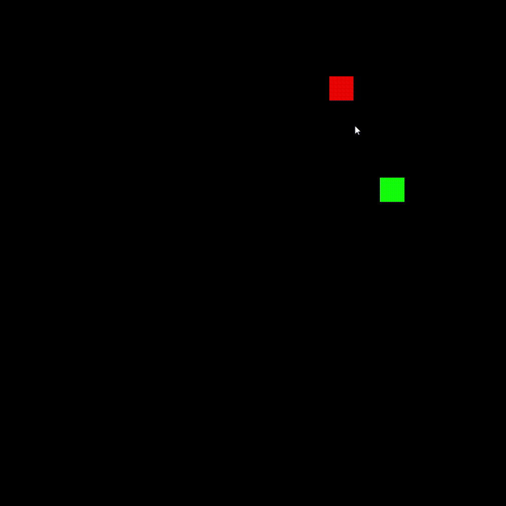

<h1 align="center" style="font-weight: bold;">Jogo da Cobrinha</h1>

<p align="center">
  
</p>

[PYTHON__BADGE]: https://img.shields.io/badge/Python-3776AB?style=for-the-badge&logo=python&logoColor=white
[PYGAME__BADGE]: https://img.shields.io/badge/Pygame_CE-000000?style=for-the-badge&logo=python&logoColor=white

<p align="center">
  <a href="#tech">Tecnologias</a> •
  <a href="#started">Iniciando</a> •
  <a href="#features">Funcionalidades</a> •
  <a href="#colab">Colaboradores</a> •
  <a href="#contribute">Contribua</a>
</p>

<p align="center">
  <b>Recreação clássica do Jogo da Cobrinha desenvolvida em Python com Pygame, utilizando lógica baseada em mosaico (grid) e gerenciamento otimizado de coordenadas.</b>
</p>

<h2 id="layout">🎨 Preview</h2>

<p align="center">
    
</p>

<h2 id="tech">💻 Tecnologias</h2>

<div>

![Python][PYTHON__BADGE]
![Pygame][PYGAME__BADGE]

</div>

<h2 id="started">🚀 Iniciando</h2>

Siga os passos abaixo para executar o jogo em sua máquina local.

<h3>Pré-requisitos</h3>

- [Python](https://www.python.org/) (Versão 3.10 ou superior recomendada)
- [Git](https://git-scm.com/)

<h3>Clonando o Repositório</h3>

```bash
git clone https://github.com/JoaoxVictorMS/Cobrinha.git
cd Cobrinha
```

<h3>Configurando o Ambiente Virtual</h3>

Crie e ative o ambiente virtual para isolar as dependências:

```bash
# Criando o ambiente virtual
python -m venv .venv

# Ativando no Windows (PowerShell)
.\.venv\Scripts\Activate.ps1

# Ativando no Windows (Git Bash / Linux / macOS)
source .venv/Scripts/activate
```

<h3>Instalando as Dependências</h3>

Com o ambiente virtual ativo, instale a biblioteca do jogo:

```bash
pip install -r requirements.txt
```

<h3>Executando o Jogo</h3>

Execute o script principal para iniciar a janela do jogo:

```bash
python main.py
```

<h2 id="features">⚙️ Funcionalidades e Mecânicas</h2>

- **Grid/Mosaico Customizado**: Renderização baseada em blocos de 50px que garante o alinhamento perfeito de movimentação e colisão.
- **Prevenção de Movimento Reverso**: Controle lógico de entradas no teclado (teclas `W`, `A`, `S`, `D`) para evitar que a cobrinha colida acidentalmente consigo mesma ao tentar inverter a direção de imediato.
- **Geração Aleatória**: Posicionamento dinâmico e inteligente de novas maçãs/comidas dentro do limite de alcances calculados.
- **Detecção de Colisão**: Reinício automático da partida ao colidir com os limites da janela de 700x700 pixels ou ao colidir com o próprio corpo.

<h2 id="colab">🤝 Colaboradores</h2>

Um agradecimento especial a todos que contribuíram para o desenvolvimento deste projeto.

<table>
  <tr>
    <td align="center">
      <a href="https://github.com/JoaoxVictorMS">
        <br>
        <sub>
          <b>João Victor</b>
        </sub>
      </a>
    </td>
  </tr>
</table>

<h2 id="contribute">📫 Contribua</h2>

Quer contribuir com o projeto? Siga os passos abaixo:

1. Faça um Fork do projeto
2. Crie uma Branch para sua Feature (`git checkout -b feature/NovaFuncionalidade`)
3. Faça o commit das suas alterações (`git commit -m 'Adiciona nova funcionalidade'`)
4. Faça o Push para a Branch (`git push origin feature/NovaFuncionalidade`)
5. Abra um Pull Request

<h3>Documentações Úteis</h3>

[📝 Como criar um Pull Request](https://www.atlassian.com/br/git/tutorials/making-a-pull-request) •
[💾 Padrão de commits](https://gist.github.com/joshbuchea/6f47e86d2510bce28f8e7f42ae84c716)
